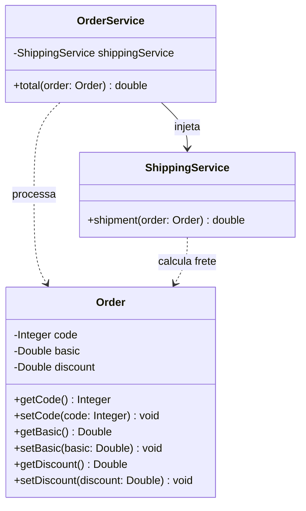

# 📦 Desafio: Componentes e Injeção de Dependência

Este repositório contém a solução do desafio **Componentes e Injeção de Dependência**, proposto no módulo de Back-end do curso Formação Desenvolvedor Moderno pela **DevSuperior**.

O objetivo principal deste desafio é implementar um sistema em Java com **Spring Boot** capaz de calcular o valor total de um pedido, aplicando regras de desconto e cálculo de frete através de componentes desacoplados e registrados com `@Service`.

## 🎯 Sobre o Sistema e Regras de Negócio

O sistema consiste em calcular o valor total de um pedido com base nas seguintes regras:

1. **Desconto:** O valor do desconto percentual é aplicado sobre o valor básico do pedido.

2. **Frete:** O valor do frete é calculated de acordo com a tabela abaixo (baseado no valor básico do pedido sem desconto):

| Valor básico do pedido (sem desconto) | Frete     |
| ------------------------------------- | --------- |
| Abaixo de R\$ 100.00                  | R\$ 20.00 |
| De R\$ 100.00 até R$ 200.00 exclusive | R\$ 12.00 |
| R\$ 200.00 ou mais                    | Grátis    |

3. **Valor Total:** O valor total do pedido é obtido aplicando o desconto ao valor básico do pedido e adicionando o valor do frete.

## 💻 Exemplo de Entrada e Saída

### Entrada

| Entrada                      | Exemplo 1 | Exemplo 2 | Exemplo 3 |
| ---------------------------- | --------- | --------- | --------- |
| **Código do pedido:**        | 1034      | 2282      | 1309      |
| **Valor básico:**            | 150.00    | 800.00    | 95.90     |
| **Porcentagem de desconto:** | 20.0      | 10.0      | 0.0       |

### Saída

| Saída              | Exemplo 1  | Exemplo 2  | Exemplo 3  |
| ------------------ | ---------- | ---------- | ---------- |
| **Pedido código:** | 1034       | 2282       | 1309       |
| **Valor total:**   | R\$ 132.00 | R\$ 720.00 | R\$ 115.90 |

## 📁 Estrutura do Projeto

```text
desafioCalcularPedido/
├── src/
│   ├── main/
│   │   ├── java/
│   │   │   └── br/
│   │   │       └── com/
│   │   │           └── ivanferreira/
│   │   │               └── desafioCalcularPedido/
│   │   │                   ├── entities/
│   │   │                   │   └── Order.java
│   │   │                   ├── services/
│   │   │                   │   ├── OrderService.java
│   │   │                   │   └── ShippingService.java
│   │   │                   └── DesafioCalcularPedidoApplication.java
│   │   └── resources/
│   │       └── application.properties
└── pom.xml
```

## 🏛️ Arquitetura e Modelagem

A solução foi projetada de forma modular, dividindo as responsabilidades em serviços e entidades específicos.

### 📐 Diagrama de Classes UML



### 🧩 Componentes do Sistema

- **`Order` (Entidade/Modelo):** Representa o objeto de dados do pedido contendo `code` (código), `basic` (valor básico) e `discount` (porcentagem de desconto).
- **`OrderService` (Serviço):** Componente anotado com `@Service`, responsável por operações referentes a pedidos e pelo cálculo do valor final combinando o desconto com o frete.
- **`ShippingService` (Serviço):** Componente anotado com `@Service`, responsável por operações referentes ao frete conforme a regra de valor básico.

## 🛠️ Tecnologias Utilizadas

- **Linguagem & Framework:** Java 17+, Spring Boot
- **Build & Dependências:** Apache Maven

## 🍃 Sobre

Desafio prático desenvolvido durante a formação Desenvolvedor Moderno - Coleção Java Spring da plataforma 🍃 **DevSuperior**.

## 👤 Autor

Desenvolvido por **Ivan Ferreira**.

Copyright © 2026 Ivan Ferreira. Todos os direitos reservados.
