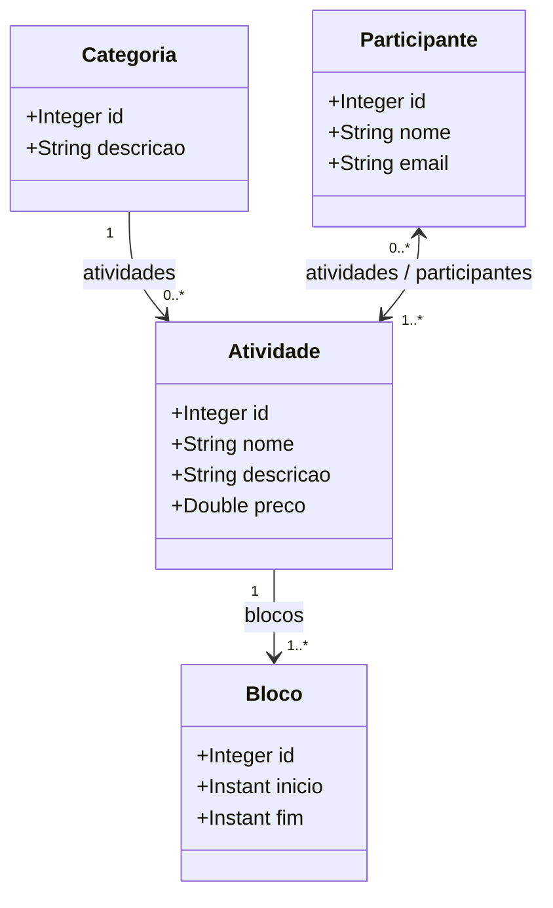

# 🏫 Desafio: Modelo de Domínio e ORM — Sistema EVENTO

Este repositório contém a solução do desafio **Modelo de Domínio e ORM**, proposto no módulo de Back-end do curso Formação Desenvolvedor Moderno pela **DevSuperior**.

O objetivo principal deste desafio é implementar um modelo conceitual completo em **Java com Spring Boot**, mapeando entidades com **JPA/Hibernate** para persistência no banco de dados em memória **H2 Database**, além de realizar o _seeding_ (povoamento automático) dos dados no startup da aplicação.

---

## 🎯 Sobre o Sistema e Especificações

O **Sistema EVENTO** gerencia participantes e atividades de um evento acadêmico (como palestras, cursos e oficinas).

### Regras de Negócio e Relacionamentos:

1. **Categoria:** Uma atividade possui uma categoria (ex: Curso, Oficina). Uma categoria pode ter várias atividades ($1 \to N$).
2. **Atividade:** Uma atividade tem nome, descrição, preço e pertence a uma categoria. Além disso, uma atividade pode ser dividida em um ou mais **Blocos** de horário e possui múltiplos **Participantes** inscritos.
3. **Bloco:** Representa a alocação de tempo de uma atividade (com data/hora de início e fim). Um bloco pertence a uma única atividade ($N \to 1$).
4. **Participante:** Cada participante tem nome e e-mail. Um participante pode se inscrever em várias atividades, e uma atividade pode ter vários participantes ($N \to N$).

---

## 📁 Estrutura do Projeto

```text
ds-evento-orm/
├── src/
│   ├── main/
│   │   ├── java/
│   │   │   └── br/
│   │   │       └── com/
│   │   │           └── ivanferreira/
│   │   │               └── evento/
│   │   │                   ├── entities/
│   │   │                   │   ├── Atividade.java
│   │   │                   │   ├── Bloco.java
│   │   │                   │   ├── Categoria.java
│   │   │                   │   └── Participante.java
│   │   │                   ├── repositories/
│   │   │                   │   ├── AtividadeRepository.java
│   │   │                   │   ├── BlocoRepository.java
│   │   │                   │   ├── CategoriaRepository.java
│   │   │                   │   └── ParticipanteRepository.java
│   │   │                   └── EventoApplication.java
│   │   └── resources/
│   │       ├── application.properties
│   │       └── import.sql
│   └── test/
└── pom.xml
```

---

## 🏛️ Arquitetura e Modelagem

### 📐 Diagrama de Classes (UML / Mermaid)



---

## 💾 Instância de Dados (Seeding / Povoamento)

O povoamento da base de dados é realizado automaticamente via `import.sql` na inicialização do projeto com os seguintes dados:

### 1. Categorias

- `c1`: ID 1 | Descrição: **Curso**
- `c2`: ID 2 | Descrição: **Oficina**

### 2. Atividades

- `a1`: ID 1 | **Curso de HTML** | _Aprenda HTML de forma prática_ | R$ 80.00 | Categoria: `c1`
- `a2`: ID 2 | **Oficina de Github** | _Controle versões de seus projetos_ | R$ 50.00 | Categoria: `c2`

### 3. Blocos de Horário

- `b1`: ID 1 | Início: `2017-09-25T08:00:00Z` | Fim: `2017-09-25T11:00:00Z` | Atividade: `a1`
- `b2`: ID 2 | Início: `2017-09-25T14:00:00Z` | Fim: `2017-09-25T18:00:00Z` | Atividade: `a2`
- `b3`: ID 3 | Início: `2017-09-26T08:00:00Z` | Fim: `2017-09-26T11:00:00Z` | Atividade: `a2`

### 4. Participantes e Inscrições

- `p1`: **José Silva** (`jose@gmail.com`) $\to$ Inscrito em `a1`, `a2`
- `p2`: **Tiago Faria** (`tiago@gmail.com`) $\to$ Inscrito em `a1`
- `p3`: **Maria do Rosário** (`maria@gmail.com`) $\to$ Inscrita em `a1`, `a2`
- `p4`: **Teresa Silva** (`teresa@gmail.com`) $\to$ Inscrita em `a2`

---

## 🛠️ Tecnologias Utilizadas

- **Linguagem:** Java 17+
- **Framework:** Spring Boot 3+ (Spring Data JPA)
- **Banco de Dados em Memória:** H2 Database
- **Gerenciador de Dependências:** Apache Maven

<br />

<div align="center">


</div>

---

## ⚙️ Como Executar a Aplicação

1. **Clonar o repositório:**

   ```bash
   git clone https://github.com/ivanfsilva/ds-evento-orm.git
   ```

2. **Executar a aplicação:**
   Pela sua IDE (IntelliJ / Eclipse / VS Code) ou via linha de comando:

   ```bash
   mvn spring-boot:run
   ```

3. **Acessar o H2 Console:**
   - **URL do navegador:** `http://localhost:8080/h2-console`
   - **JDBC URL:** `jdbc:h2:mem:testdb`
   - **User Name:** `sa`
   - **Password:** _(em branco)_

---

## 🍃 Sobre

Desafio prático desenvolvido durante a formação Desenvolvedor Moderno - Coleção Java Spring da plataforma 🍃 **DevSuperior**.

---

## 👤 Autor

Desenvolvido por **Ivan Ferreira**.

Copyright © 2026 Ivan Ferreira. Todos os direitos reservados.
